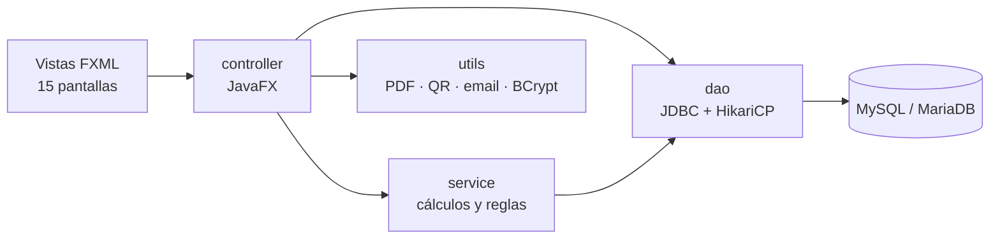

# GestionAp PRO

**Aplicación de escritorio para gestionar el alquiler de habitaciones en pisos compartidos: inquilinos, contratos, pagos, incidencias y rentabilidad de cada piso, en un solo sitio.**


> **English summary:** Desktop app (Java 21, JavaFX, MySQL, plain JDBC) to manage shared-flat room rentals: tenants, contracts, payments, maintenance issues and per-flat profitability. Layered architecture (DAO / service / controller), BCrypt passwords, PDF contracts with iText, SEPA payment QR codes and 189 JUnit 5 tests, including DAO tests on an in-memory H2 database.

---

## Qué resuelve

Muchos propietarios de pisos compartidos llevan los alquileres con papel o Excel: pagos que no cuadran, incidencias sin registrar y contratos que vencen sin avisar. GestionAp PRO lo reúne todo en una aplicación con login y roles.

## Funcionalidades

- **Panel principal** con ingresos del mes, ocupación y avisos de contratos que vencen.
- **Pisos y habitaciones**: estado de cada habitación (libre, alquilada, en mantenimiento) y ficha de cada piso.
- **Inquilinos y contratos**: alta de inquilinos, contratos por habitación y generación del contrato en **PDF** (iText 7).
- **Pagos**: control mensual de quién ha pagado, y **código QR de transferencia SEPA** (estándar EPC) por inquilino. El IBAN del QR es de ejemplo.
- **Incidencias** con su coste de reparación.
- **Rentabilidad**: rentabilidad bruta y neta, cash flow, cuota de hipoteca, ROCE, capital propio, plusvalía y PER de cada piso; calculadora con el ITP de cada comunidad autónoma.
- **Calendario y estadísticas** con gráficos.
- **Usuarios y roles** (administrador y usuario), contraseñas con **BCrypt** y envío de emails a inquilinos.
- **XML + XSD**: los contratos están modelados en XML con un esquema que valida sus reglas (ver [`docs/README_xml.md`](docs/README_xml.md)).

## Stack

| Capa | Tecnología |
|---|---|
| Lenguaje | Java 21 |
| Interfaz | JavaFX 21 + FXML + CSS (tema claro y oscuro) |
| Datos | MySQL 8 / MariaDB, JDBC puro con pool HikariCP |
| Seguridad | BCrypt (jBCrypt), con migración de hashes SHA-256 antiguos |
| Documentos | iText 7 (PDF), ZXing (QR), JavaMail |
| Tests | JUnit 5 + H2 en modo MySQL para los DAO |
| Build | Maven, con empaquetado nativo preparado para jpackage |

## Arquitectura



Los cálculos financieros y las reglas de vencimiento de contratos están en `service/`, separados de la interfaz para poder probarlos sin abrir ventanas.

## Cómo ejecutarlo

**Descarga para macOS:** hay un `.dmg` en [Releases](https://github.com/nelsongomezsa/gestionAPPRO/releases/tag/v1.0.0). Necesita igualmente una base de datos MySQL o MariaDB.

Para ejecutarlo desde el código: JDK 21, Maven 3.9+ y MySQL 8 o MariaDB.

1. **Clona el repositorio**
   ```bash
   git clone https://github.com/nelsongomezsa/gestionAPPRO.git && cd gestionAPPRO
   ```
2. **Prepara la base de datos** con los scripts de [`sql/`](sql/): `base_datos.sql` crea las tablas principales y el resto añade usuarios, notificaciones, actividad, datos financieros y datos de demo. Después copia la plantilla de conexión y pon tus credenciales:
   ```bash
   cp src/main/resources/database.properties.example src/main/resources/database.properties
   ```
3. **Arranca la aplicación**
   ```bash
   mvn javafx:run
   ```

> `database.properties` está en el `.gitignore`: tus credenciales nunca se suben al repositorio.

## Tests

```bash
mvn test
```

**189 tests** con JUnit 5, sin necesidad de MySQL:

- `service/`: calculadora financiera, vencimiento de contratos, historial de navegación y rutas de notificación.
- `dao/`: consultas reales contra una base **H2 en memoria en modo MySQL**.
- `model/` y `utils/`: reglas de las entidades y hash de contraseñas.

## Qué aprendí

- A separar la lógica de la interfaz: sacar los cálculos financieros de los controladores a `CalculadoraFinancieraPiso` hizo posible probarlos con 35 tests.
- A probar el acceso a datos sin tocar la base real, con H2 en modo MySQL.
- A cuidar los recursos: el pool de conexiones no se cerraba al salir de la app, y lo corregí.
- A migrar contraseñas de SHA-256 a BCrypt sin obligar a nadie a cambiarlas.

## Próximos pasos

- Unificar los scripts de `sql/` en una sola migración: ahora usan dos nombres de base de datos (`gestion_alquileres` y `gestion_alquileres_pro`).
- Automatizar el empaquetado nativo con jpackage (`.dmg` / `.exe`).
- Añadir capturas de la versión actual a este README.

## Proyectos relacionados

- [GestionAp PRO API + iOS](https://github.com/nelsongomezsa/gestionapro): API REST con Spring Security y app iOS sobre la misma base de datos.
- [GestionAP](https://github.com/nelsongomezsa/GestionAP): la versión inicial, de 1.º de DAM.

## Contexto

Empezó como Proyecto Intermodular de 1.º de DAM en Prometeo by thePower (Bases de Datos, Programación, Lenguajes de Marcas, Sistemas Informáticos y Entornos de Desarrollo) y lo he seguido ampliando por mi cuenta.

## Autor

**Nelson Gómez Sánchez** · Estudiante de DAM y del Máster en Data & Analytics · [nelsongomezsa.github.io](https://nelsongomezsa.github.io) · [LinkedIn](https://www.linkedin.com/in/nelson-gómez-sánchez)

Licencia [MIT](LICENSE).
